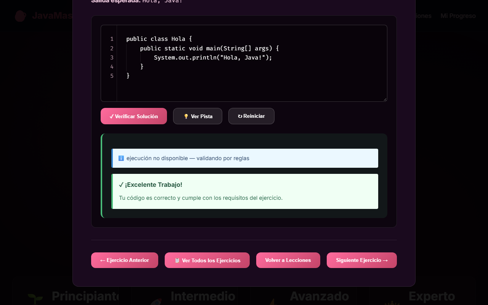

# JavaMaster

Plataforma gratuita en español para aprender Java con práctica, sin pagar bootcamps.

> **Estado:** proyecto personal en desarrollo. El contenido funciona; el login,
> la base de datos y la ejecución real de código todavía no existen.

**Demo:** https://java.belencalvo.me



## Qué funciona hoy

- 52 lecciones en español, organizadas en 4 niveles (Principiante 15,
  Intermedio 15, Avanzado 12, Experto 10).
- 208 ejercicios con enunciado, código inicial, solución y pista.
- Validación instantánea por reglas en el navegador, sin servidor.
  Si la ejecución no está disponible, la app lo dice y valida por reglas:
  "ejecución no disponible — validando por reglas".
- Progreso guardado solo en este navegador, con aviso visible de esa limitación.
- 4 páginas de guía por nivel (HTML, se pueden imprimir o guardar como PDF
  desde el navegador).
- Sitio estático: funciona en cualquier navegador moderno sin backend.

## Próximos pasos

- Login y base de datos.
- Progreso guardado por usuario (multi-dispositivo).
- Ejecución real de código en servidor.
- Exámenes por nivel.

## Stack

- **HTML5, CSS3 y JavaScript vanilla:** sin framework ni build, para que el sitio
  sea estático y barato de hospedar.
- **`validator.js` (reglas en el cliente):** da feedback inmediato sin servidor
  ni costo operativo.
- **`localStorage`:** guarda el progreso sin cuentas ni backend en esta versión,
  con aviso de su límite.
- **GitHub Pages + dominio propio:** hosting estático sin costo.
- **Backend Express + JDK y Firebase/Auth (no incluidos en esta versión):**
  la ejecución real y las cuentas están en rediseño; el código de ejemplo está
  desactivado.

## Cómo correrlo localmente

Requisitos: Git y Python 3. No se necesita Node.js, JDK ni backend.

```bash
git clone https://github.com/belcalvo93/java-learning-platform.git
cd java-learning-platform
python -m http.server 8000
```

Abrir http://localhost:8000 en el navegador.

## Decisiones y aprendizajes

- Seguridad primero: cuando detecté una API key expuesta, la revoqué y suspendí
  el backend hasta tener ejecución segura con tests, en lugar de dejarlo
  funcionando con riesgo.
- Publicar primero el frontend estático: priorizar que el contenido esté
  disponible gratis y sin costo de hosting, y sumar login y base de datos
  después.
- Validar el concepto y no el texto exacto: el validador acepta distintos
  nombres de variable y textos de salida, porque el objetivo es que la persona
  aprenda la idea, no que adivine la respuesta literal.
- Consignas claras: reescribí las consignas y agregué introducción a las
  lecciones porque las originales eran ambiguas.

## Uso de IA

Desarrollado con asistencia de herramientas de IA (Antigravity y OpenCode);
las decisiones de producto y la revisión son mías.

## Autora

**Belén Calvo** — beluucalvo@live.com.ar

- GitHub: https://github.com/belcalvo93
- LinkedIn: https://www.linkedin.com/in/belucalvo/

Licencia: MIT (ver LICENSE).
